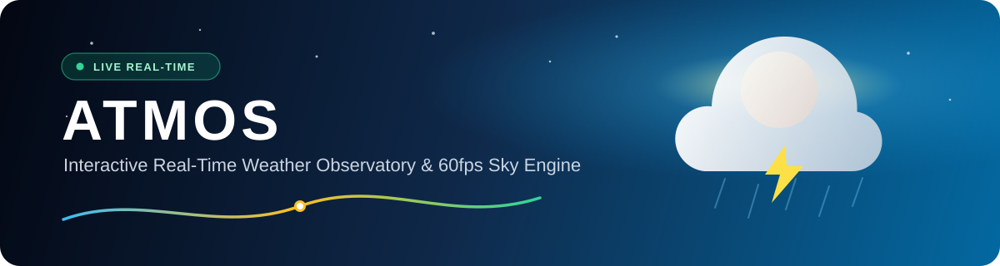

<div align="center">



<br />

# ⛅ ATMOS — Observatorium Cuaca Interaktif Real-Time

**Website cuaca interaktif modern dengan animasi langit 60fps, suara atmosfer prosedural, deteksi lokasi otomatis, dan data meteorologi & kualitas udara real-time — 100% tanpa API key dan tanpa *build step*.**

<p>
  
  
  
  
  
  
  
</p>

<p>
  <a href="#-fitur-unggulan">✨ Fitur</a> •
  <a href="#-efek-animasi-langit">🎬 Efek Langit</a> •
  <a href="#-sumber-data-real-time">🛰️ Data Real-Time</a> •
  <a href="#-cara-menjalankan">🚀 Menjalankan</a> •
  <a href="./docs/ARCHITECTURE.md">🏗️ Arsitektur</a>
</p>

</div>

---

## ✨ Fitur Unggulan

| Ikon | Fitur | Deskripsi |
| :---: | :--- | :--- |
| 📍 | **Deteksi Lokasi Otomatis** | Otomatis menyesuaikan lokasi user saat halaman dibuka menggunakan **Browser GPS** dengan *fallback* mulus ke **deteksi lokasi IP**, ditambah tombol target GPS (`⌖`) untuk kembali kapan saja. |
| 🎨 | **Animasi Langit 60fps** | Kanvas HTML5 *fullscreen* yang berubah dinamis mengikuti cuaca aktual dan fase waktu lokal kota (**Fajar, Siang, Senja, Malam**) lengkap dengan *pointer parallax*. |
| ⛈️ | **Playground Efek Langit** | Coba langsung seluruh simulasi cuaca (**Cerah, Senja, Malam, Mendung, Hujan, Badai Petir, Salju, Kabut**) dari dock interaktif, lalu kembali ke **● Live Real** dalam satu klik. |
| 📈 | **Grafik 24 Jam Interaktif** | Kurva SVG halus (*cubic Bezier*) yang bisa digeser (*hover/touch scrub*) untuk inspeksi detail **Suhu**, **Peluang Hujan**, **Kecepatan Angin**, dan **Indeks UV**. |
| 📅 | **Prakiraan 7 Hari Expandable** | Bilah rentang suhu proporsional mingguan; klik baris hari mana saja untuk membuka detail jam terbit/terbenam, UV maks, kecepatan angin maks, dan curah hujan. |
| 🧭 | **Telemetri Atmosfer Visual** | **Kompas Angin** beranimasi, **Lintasan Matahari (Sun Arc)** real-time, **Kualitas Udara (US AQI, PM2.5, PM10, O₃)**, **Indeks UV**, **Kelembapan & Titik Embun**, serta **Barometer & Jarak Pandang**. |
| 🔊 | **Suara Atmosfer Prosedural** | Sintesis suara hujan, hembusan angin, dan gemuruh petir real-time menggunakan **Web Audio API** — tanpa file audio eksternal. |
| 🌍 | **Pencarian Global & Favorit** | Pencarian kota seluruh dunia dengan *autocomplete* & navigasi keyboard, kota favorit tersimpan di `localStorage`, jam lokal kota *live ticking*, serta toggle satuan **`°C / °F`**. |

---

## 🎬 Efek Animasi Langit

Mesin `SkyEngine` (`js/skyEngine.js`) merender suasana langit secara real-time di 60fps:

- ☀️ **Cerah Siang** — Gradien langit biru cerah, halo matahari hangat, berkas sinar berputar perlahan, dan partikel cahaya melayang.
- 🌇 **Fajar & Senja (*Golden Hour*)** — Palet langit jingga-amber saat mendekati jam `sunrise` / `sunset` lokal.
- 🌙 **Malam Berbintang** — Langit malam dalam dengan bintang berkelip berlapis, bulan berkawah dengan halo, dan bintang jatuh acak.
- ☁️ **Berawan & Mendung** — Awan volumetrik 3 lapisan yang melayang sesuai kecepatan angin aktual.
- 🌧️ **Hujan & Gerimis** — Tetesan hujan miring mengikuti arah/kecepatan angin dengan percikan halus di tepi bawah.
- ⛈️ **Badai Petir** — Hujan deras, awan gelap, kilatan petir bercabang prosedural + sinkronisasi suara guntur. *(Tips: klik tombol **Badai Petir** berulang kali untuk memicu sambaran petir manual!)*
- ❄️ **Salju & 🌫️ Kabut** — Serpihan salju berayun lembut dan lapisan kabut bergelombang.

---

## 🛰️ Sumber Data Real-Time

Semua data cuaca dan kualitas udara bersifat **100% live** dan gratis tanpa konfigurasi API key:

| Layanan | Endpoint / Kegunaan |
| :--- | :--- |
| ☁️ **Open-Meteo Forecast API** | Suhu, rasa suhu, kode cuaca WMO, kelembapan, titik embun, angin, hembusan, UV, visibilitas, barometer, prakiraan 24 jam & 7 hari |
| 🍃 **Open-Meteo Air Quality API** | US AQI, European AQI, PM2.5, PM10, Ozon (O₃), dan NO₂ |
| 🔎 **Open-Meteo Geocoding API** | Pencarian kota seluruh dunia beserta koordinat & kode negara |
| 📍 **BigDataCloud + GeoJS / ipwho.is** | Reverse geocoding GPS & *fallback* deteksi lokasi otomatis |

---

## 🚀 Cara Menjalankan Secara Lokal

Karena aplikasi ini menggunakan **ES Modules** (`<script type="module">`), jalankan melalui server HTTP lokal (bukan membuka `file://` secara langsung):

### 1️⃣ Clone Repository
```bash
git clone https://github.com/Freddy47588/atmos-live.git
cd atmos-live
```

### 2️⃣ Jalankan Server Lokal
Pilih salah satu perintah berikut:

```bash
# Menggunakan Node.js (npx)
npx serve .

# Atau menggunakan Python 3
python -m http.server 8080
```

### 3️⃣ Buka di Browser
Kunjungi `http://localhost:3000` (untuk `npx serve`) atau `http://localhost:8080` (untuk Python).

---

## ⌨️ Pintasan & Interaksi

| Kontrol / Aksi | Fungsi |
| :--- | :--- |
| `↓` / `↑` di kotak pencarian | Navigasi daftar hasil kota |
| `Enter` | Pilih kota yang disorot |
| `Esc` | Tutup dropdown pencarian |
| 🎯 Klik / geser grafik 24 jam | Inspeksi cuaca & metrik per jam secara presisi |
| ⭐ Tombol Bintang | Simpan / hapus kota dari bar akses cepat |
| 📍 Tombol Target GPS (`⌖`) | Deteksi ulang & kembali ke lokasi user saat ini |
| 🔊 Tombol Suara | Aktifkan / matikan suara atmosfer Web Audio |
| ⛈️ Klik ulang **Badai Petir** | Memicu sambaran petir + guntur manual |

---

## 🌐 Deploy Gratis (Static Hosting)

Karena tidak memerlukan proses build, **ATMOS** bisa langsung di-deploy ke:
- **GitHub Pages** — Aktifkan di *Settings → Pages → Deploy from `main` branch (`/root`)*.
- **Netlify / Vercel / Cloudflare Pages** — Cukup sambungkan repository ini tanpa *build command* dan set output directory ke `.`.

---

## 📚 Dokumentasi Lanjutan

Ingin melihat diagram alur modul, cara kerja `SkyEngine`, dan arsitektur `SoundEngine` secara mendalam?
👉 Baca **[docs/ARCHITECTURE.md](./docs/ARCHITECTURE.md)**

---

## 📄 Lisensi

Proyek ini dirilis di bawah lisensi **[MIT](./LICENSE)**. Bebas digunakan, dimodifikasi, dan dikembangkan lebih lanjut.

<div align="center">
  <sub>Dibuat dengan ❤️ oleh <a href="https://github.com/Freddy47588">Freddy47588</a> · Data oleh <a href="https://open-meteo.com/">Open-Meteo</a></sub>
</div>
