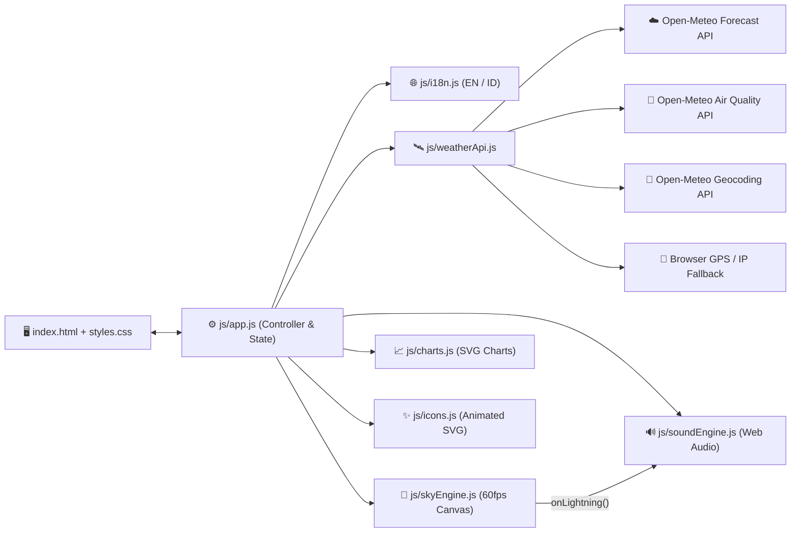

# 🏗️ Technical Architecture — ATMOS

This document outlines the modular architecture, real-time data pipeline, 60fps Canvas sky engine, bilingual localization system, and procedural Web Audio synthesizer powering **ATMOS**.

---

## 🧭 Module Dependency Flow



---

## 📦 Module Breakdown

### 1. 🛰️ `js/weatherApi.js` — Real-Time Data Layer
Handles fetching, normalizing, and interpreting global meteorological data without requiring API keys:
- **`fetchWeatherBundle(lat, lon)`**: Fetches Forecast (`current`, `hourly`, `daily`) and Air Quality (`us_aqi`, `european_aqi`, `pm2_5`, `pm10`, `ozone`, `no2`) in parallel via `Promise.all`.
- **`fetchQuickWeather(cities)`**: Batch-fetches live temperatures for all quick-bar cities in a single multi-coordinate Open-Meteo request.
- **`searchCities(query, signal, lang)`**: Live worldwide geocoding autocomplete with `AbortController` race-condition protection.
- **`reverseGeocode(lat, lon, lang)` & `detectLocationByIp()`**: Resolves browser GPS coordinates via BigDataCloud with an automatic IP-based fallback chain (`get.geojs.io` → `ipwho.is`).
- **`interpretWmoCode(code, isDay, lang)`**: Maps standard **WMO Weather Interpretation Codes (0–99)** into localized descriptions, animated SVG icon keys, sky scenes (`clear`, `partly-cloudy`, `overcast`, `rain`, `storm`, `snow`, `fog`), and particle intensities (`0.0–1.0`).

### 2. 🌐 `js/i18n.js` — Bilingual Localization (`ID / EN`)
- Centralized translation dictionary for **Indonesian (`id`)** and **English (`en`)** persisted via `localStorage` (`atmos_lang_v1`).
- Covers static UI labels (`data-i18n`), WMO weather states, wind cardinals, Beaufort scale descriptions, AQI/UV advice, smart contextual insights, localized `Intl.DateTimeFormat` dates, and toast notifications.

### 3. 🎨 `js/skyEngine.js` — 60fps HTML5 Canvas Sky Engine
DPR-scaled (`≤ 2x`) real-time canvas engine with `prefers-reduced-motion` support:
- **Smooth Sky Interpolation**: Per-frame RGB linear interpolation across 3-stop sky gradients driven by `scene × timePhase` (`dawn`, `day`, `golden`, `night`).
- **Pointer Parallax**: Subtle cursor-driven depth offset across celestial bodies, stars, and 3 cloud depth layers.
- **Adaptive Particle Systems**: Rotating sunbeams & dust motes, twinkling stars + shooting stars, wind-angled rain with splash ripples, procedural branching lightning bolts with flash bloom (`onLightning` hook), swaying snowflakes, and layered drifting fog.

### 4. 📈 `js/charts.js` — Interactive SVG Visualizations
- **24-Hour Forecast (`renderHourlyChart`)**: Catmull-Rom cubic Bezier spline with pointer-capture hover/drag scrubbing for Temperature, Rain Probability, Wind Speed, and UV Index.
- **Sun Trajectory (`renderSunArc`)**: Quadratic Bezier solar arc calibrated against each city's real `sunrise` and `sunset` timestamps.
- **Wind Compass (`renderWindCompass`)**: Smoothly rotated vector needle with localized cardinal labels (`N/E/S/W` or `U/T/S/B`).

### 5. 🔊 `js/soundEngine.js` — Procedural Web Audio Engine
Pure browser-native synthesis with zero external audio assets:
- Generates a seamless 4-second stereo pink-noise buffer routed through an LFO-modulated `BiquadFilterNode` (`lowpass` for rain/storm, `bandpass` for gentle breeze/snow/fog).
- **`playThunder()`**: Synthesizes a low-frequency decaying rumble (`190 Hz → 52 Hz`) triggered whenever lightning flashes on the canvas.

### 6. ⚙️ `js/app.js` — Application State & Controller
- **Automatic Location Bootstrap**: Runs `navigator.geolocation` → `detectLocationByIp()` → default city fallback on initial visit (`auto` mode), while respecting manual city selection until the user clicks the GPS button again.
- **Live City Clock**: Computes the target city's exact local time every second from `utc_offset_seconds`.
- **Auto Sync**: Refreshes weather data silently every **10 minutes**.

---

## 🗂️ Project Structure

```text
atmos-live/
├── assets/
│   ├── banner.svg        # Custom README hero banner
│   └── favicon.svg       # Vector app icon
├── css/
│   └── styles.css        # Adaptive glassmorphism, bento layout & icon animations
├── docs/
│   └── ARCHITECTURE.md   # Technical architecture & module docs
├── js/
│   ├── app.js            # Main controller, state, auto-location, i18n & FX dock
│   ├── charts.js         # Interactive 24h SVG chart, Sun Arc & Wind Compass
│   ├── i18n.js           # Bilingual EN / ID translation dictionary
│   ├── icons.js          # Animated custom SVG weather icons
│   ├── skyEngine.js      # 60fps HTML5 Canvas sky & particle physics engine
│   ├── soundEngine.js    # Procedural Web Audio API weather ambience
│   └── weatherApi.js     # Open-Meteo Forecast, AQI, Geocoding & IP fallback
├── .gitignore
├── index.html
├── LICENSE
└── README.md
```
