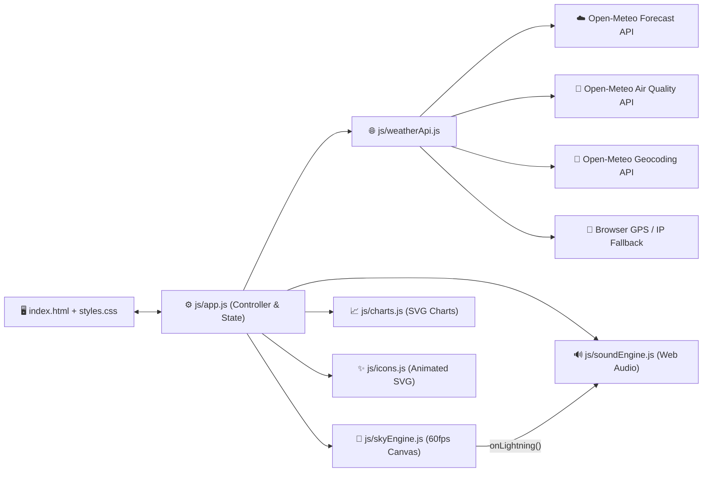

# 🏗️ Arsitektur & Dokumentasi Teknis — ATMOS

Dokumen ini menjelaskan arsitektur modul, alur data real-time, mesin animasi kanvas, dan sintesis audio prosedural yang menggerakkan **ATMOS**.

---

## 🧭 Diagram Alur Modul



---

## 📦 Rincian Modul

### 1. 🌐 `js/weatherApi.js` — Lapisan Data Real-Time
Bertanggung jawab mengambil, menormalisasi, dan menginterpretasi data cuaca global tanpa memerlukan API key:
- **`fetchWeatherBundle(lat, lon)`**: Mengambil data *Forecast* (`current`, `hourly`, `daily`) dan *Air Quality* (`us_aqi`, `european_aqi`, `pm2_5`, `pm10`, `ozone`, `no2`) secara paralel via `Promise.all`.
- **`fetchQuickWeather(cities)`**: Batch-fetch suhu ringkas untuk seluruh kota di bar akses cepat dalam satu request Open-Meteo multi-koordinat.
- **`searchCities(query, signal)`**: Pencarian kota instan berbasis Open-Meteo Geocoding API dengan dukungan `AbortController`.
- **`reverseGeocode(lat, lon)` & `detectLocationByIp()`**: Resolusi nama kota dari GPS browser (BigDataCloud) dengan *fallback* otomatis berbasis IP (`get.geojs.io` → `ipwho.is`).
- **`interpretWmoCode(code, isDay)`**: Memetakan seluruh standar **WMO Weather Interpretation Codes (0–99)** ke deskripsi Bahasa Indonesia, nama ikon SVG, kategori adegan langit (`clear`, `partly-cloudy`, `overcast`, `rain`, `storm`, `snow`, `fog`), dan tingkat intensitas partikel (`0.0–1.0`).

### 2. 🎨 `js/skyEngine.js` — Mesin Animasi Langit 60fps
Mesin rendering berbasis HTML5 Canvas dengan dukungan `devicePixelRatio` hingga `2x` dan `prefers-reduced-motion`:
- **Interpolasi Warna Halus**: Transisi gradien 3-titik langit (`top`, `mid`, `bottom`) diinterpolasi per frame berdasarkan kombinasi `scene` × `phase` (`dawn`, `day`, `golden`, `night`).
- **Pointer Parallax**: Pergerakan kursor menggeser matahari/bulan, bintang, dan 3 lapisan kedalaman awan secara proporsional.
- **Sistem Partikel Adaptif**:
  - ☀️ **Cerah**: Halo surya berlapis, 10 berkas sinar berputar lembut, dan partikel cahaya melayang (*dust motes*).
  - 🌙 **Malam**: Ratusan bintang berkelip dengan kedalaman berbeda, bulan berkawah dengan halo, serta bintang jatuh acak (*shooting stars*).
  - 🌧️ **Hujan**: Tetesan miring yang sudutnya bereaksi terhadap `windSpeed` real-time + efek riak percikan di tepi bawah layar.
  - ⛈️ **Badai Petir**: Generator petir bercabang prosedural (*recursive-style jagged bolt*) lengkap dengan kilatan atmosfer dan callback `onLightning()` untuk menyinkronkan suara guntur.
  - ❄️ **Salju & 🌫️ Kabut**: Serpihan salju berayun sinusoidal dan pita kabut berlapis.

### 3. 📈 `js/charts.js` — Visualisasi SVG Interaktif
- **Grafik 24 Jam (`renderHourlyChart`)**: Kurva *Catmull-Rom cubic Bezier* yang mulus dengan *pointer capture scrubbing* (mouse & touch) untuk 4 metrik: Suhu, Peluang Hujan, Angin, dan UV.
- **Lintasan Matahari (`renderSunArc`)**: Kurva parabola Bezier kuadratik berdasarkan perbandingan waktu lokal saat ini terhadap timestamp `sunrise` & `sunset` nyata.
- **Kompas Angin (`renderWindCompass`)**: Jarum SVG beranimasi CSS *cubic-bezier* yang menunjuk arah angin aktual (`0°–360°`).

### 4. 🔊 `js/soundEngine.js` — Sintesis Audio Atmosfer
Menggunakan **Web Audio API** murni tanpa file `.mp3`/`.wav`:
- Menghasilkan buffer *stereo pink noise* 4 detik yang seamless.
- Memprosesnya melalui `BiquadFilterNode` (`lowpass` untuk hujan/badai, `bandpass` untuk angin/salju/kabut) yang dimodulasi LFO frekuensi rendah (`0.14 Hz`).
- **`playThunder()`**: Membangkitkan dentuman guntur berfrekuensi rendah (`190 Hz → 52 Hz`) saat kilat menyambar di kanvas.

### 5. ⚙️ `js/app.js` — State & Kontroler Utama
- **Deteksi Lokasi Otomatis**:
  1. Memeriksa mode lokasi tersimpan (`auto` vs `manual` di `localStorage`).
  2. Pada mode `auto`, mencoba `navigator.geolocation` terlebih dahulu, lalu *fallback* otomatis ke `detectLocationByIp()`, lalu *fallback* akhir ke Jakarta jika offline.
- **Jam Lokal Real-Time**: Menghitung waktu lokal kota target setiap detik menggunakan `utc_offset_seconds` dari Open-Meteo.
- **Sinkronisasi Otomatis**: Data cuaca diperbarui otomatis di latar belakang setiap **10 menit**.

---

## 🗂️ Struktur Direktori

```text
atmos-live/
├── assets/
│   ├── banner.svg        # Banner visual untuk README
│   └── favicon.svg       # Ikon vektor aplikasi
├── css/
│   └── styles.css        # Tema glassmorphism, layout bento, animasi ikon & responsif
├── docs/
│   └── ARCHITECTURE.md   # Dokumentasi teknis & arsitektur sistem
├── js/
│   ├── app.js            # Kontroler aplikasi, state, GPS auto-detect, pencarian & FX dock
│   ├── charts.js         # Grafik 24 jam scrubbable, Sun Arc & Kompas Angin SVG
│   ├── icons.js          # Koleksi ikon cuaca SVG beranimasi
│   ├── skyEngine.js      # Mesin animasi langit & partikel HTML5 Canvas 60fps
│   ├── soundEngine.js    # Mesin suara atmosfer Web Audio API
│   └── weatherApi.js     # Integrasi Open-Meteo Forecast, AQI, Geocoding & IP fallback
├── .gitignore
├── index.html
├── LICENSE
└── README.md
```
